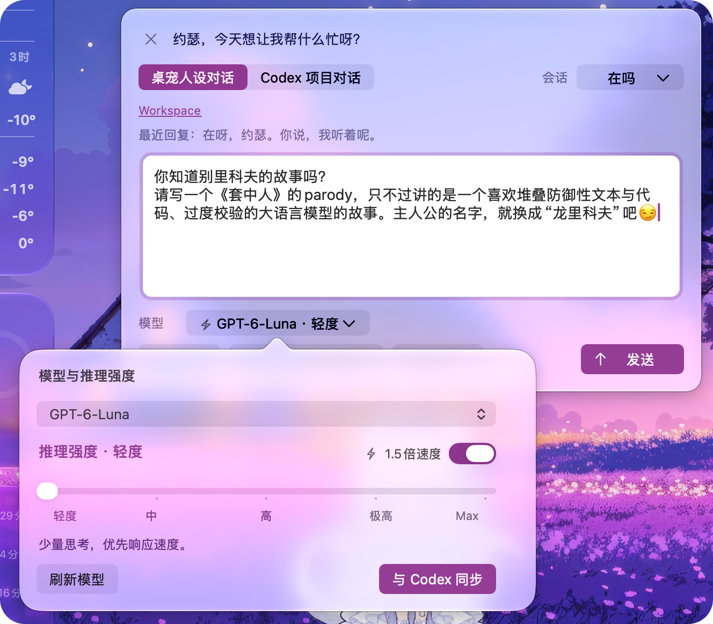
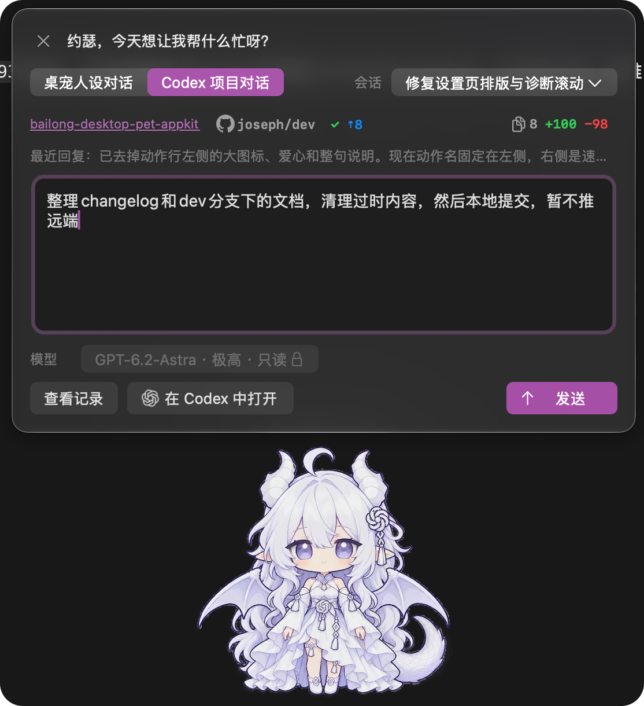
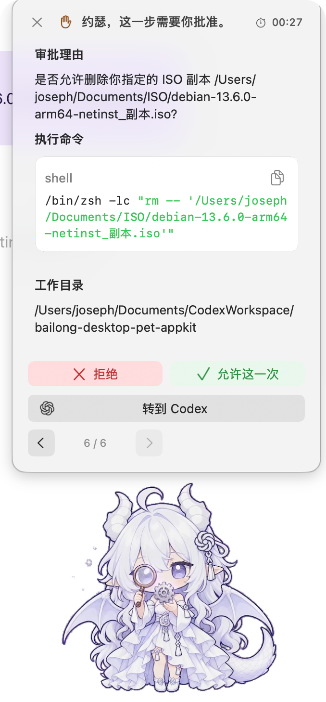
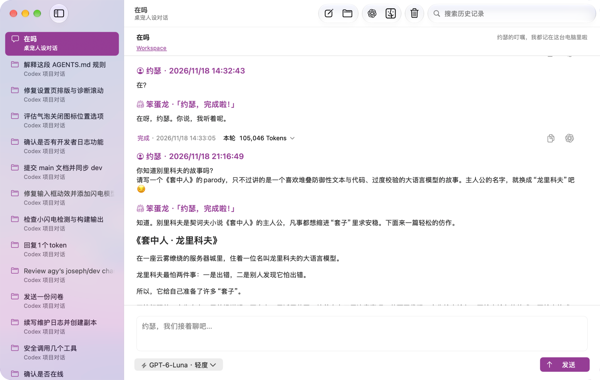
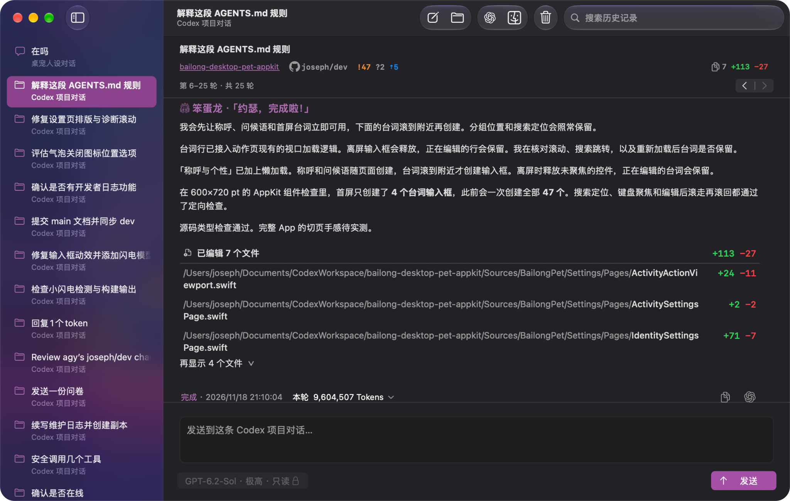
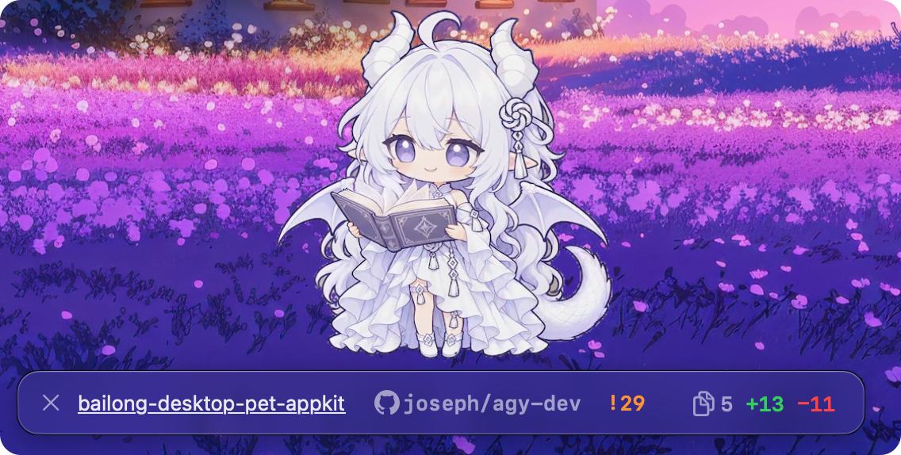
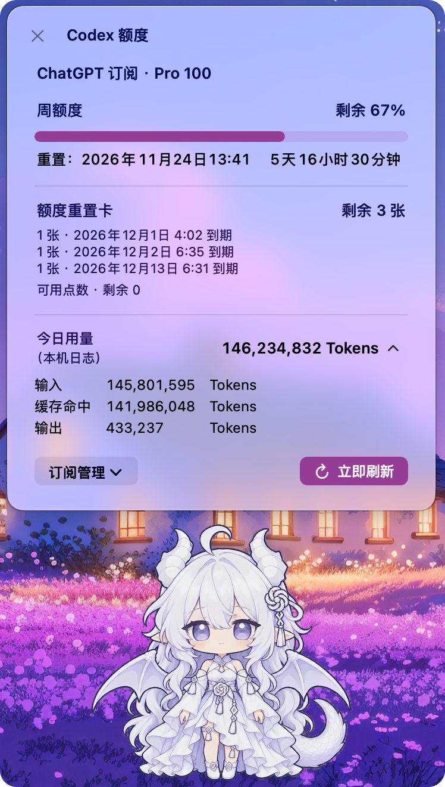

# 白龙桌宠Swift

**陪你工作，也把 Codex 的任务进展带到桌面。**

基于 [jingh12312-rgb（風-隐）的 GPT白龙娘动态桌宠](https://github.com/jingh12312-rgb/bailong-desktop-pet)，使用 Swift + AppKit 重写并独立维护的 macOS 非官方原生移植版。支持桌面互动、Codex 进展提醒、消息回复、审批处理与本机历史记录。


[下载正式版](https://github.com/Joseph-Blue/bailong-desktop-pet-mac-swift/releases/latest) · [版本变化](CHANGELOG.md) · [反馈问题](https://github.com/Joseph-Blue/bailong-desktop-pet-mac-swift/issues)

<p align="center">
  <a href=".github/images/task-progress.svg"></a>
</p>

**最新正式版：0.8.0。**

## 目录

- [下载与安装](#下载与安装)
- [先试试这些操作](#先试试这些操作)
- [特色功能](#特色功能)
- [升级与常见问题](#升级与常见问题)
- [开发](#开发)
- [来源与致谢](#来源与致谢)

## 下载与安装

需要 **macOS 14 或更新版本**。使用 Codex 相关功能，还需要在本机安装并登录 Codex。

| 你的 Mac | 下载哪个包 |
| --- | --- |
| Apple Silicon 芯片 | 文件名以 `macos-apple-silicon.zip` 结尾 |
| Intel 芯片 | 文件名以 `macos-intel.zip` 结尾，社区测试版 |

不确定机型时，打开苹果菜单 → 关于本机，查看芯片或处理器信息。Intel 社区测试版尚未经 Intel Mac 实机测试。

1. 前往[正式版下载页](https://github.com/Joseph-Blue/bailong-desktop-pet-mac-swift/releases/latest)，下载对应的 ZIP 并解压。
2. 将 `白龙桌宠Swift.app` 拖到“应用程序”或你选择的固定目录，再从访达打开。
3. 在“设置 → 通用”中选择是否随登录或 Codex 启动。

App 使用本地签名，未进行苹果公证。首次打开一定会被系统拦截。点击完成按钮，在"苹果菜单→系统设置→隐私与安全性"中找到"白龙桌宠Swift.app"并选择“仍要打开”。操作步骤见 [Apple 说明](https://support.apple.com/zh-cn/102445)。

## 先试试这些操作

| 操作 | 默认行为 |
| --- | --- |
| 单击桌宠 | 随机动画与任务概览 |
| 双击桌宠 | 查询 Codex 额度 |
| 右键单击 | 打开菜单 |
| 右键双击 | 打开临时聊天 |
| 吸边或刘海收纳后单击、拖出 | 召回桌宠 |
| 桌宠隐藏后再次打开 App | 找回桌宠，保留当前任务 |
| `⌘↩` | 气泡窗中发送消息 |
| `↩`  | 气泡窗中换行 |

鼠标动作、发送快捷键和气泡停留时间都可以在设置中调整。

## 特色功能

### 桌面陪伴，也能安静待着

桌宠可以拖动、播放落地动画，也会按设置切换动作、在桌面活动。你可以调整大小、活跃程度、活动范围和播放速度，以及各个动作出现的频率。

拖到屏幕左右边缘可以吸边收起；带刘海的 MacBook 还可以拖到内置屏幕顶部，让它倒挂收进刘海。两种收纳方式可分别开关、调整露出多少，也可指定桌宠所在的显示器。

需要专心时，开启“安静陪伴”或设置每天的安静时段：减少自主活动，停止自动移动、互动台词、进展小气泡和音效，保留最终回复与需要你处理的提醒。

### 看进展、接着聊、处理审批

Codex 工作时，桌宠会显示进展和回复。任务概览列出正在执行与最近结束的任务，点击即可回到对应的 Codex 会话。

- **思考与工具进展小气泡**默认显示 2 秒，思考摘要和工具调用可分别开关。相同内容不重复弹出。任务久无新进展时，也可按设定间隔提醒。
- **继续对话**：在气泡中点“快捷回复”，继续原会话；任务执行中也可补充要求。已有 Codex 项目对话沿用原会话的模型与思考等级。
- **桌宠人设对话**：选择工作文件夹、模型和思考等级，开启独立对话。支持快速档的官方模型可开启“1.5倍速度”；外部会话也会显示原会话的快速模式状态。
- **审批与问答**：查看理由和命令后选择拒绝或允许这一次，审批不会被回车误触。问卷支持选择、填写、翻页和跳过，保留草稿后统一提交。

<p align="center">
  <a href=".github/images/quick-chat.svg"></a>
  <a href=".github/images/project-chat.svg"></a>
</p>

<p align="center">
  <a href=".github/images/thinking-tool-progress.svg"></a>
  <a href=".github/images/approval.svg"></a>
</p>


<summary>气泡和会话的使用细节</summary>

- 气泡默认保留本次运行的 20 张消息卡片，可调整为 5～100 张；正在翻页或填写问卷时，新消息不会打断当前操作。
- 鼠标移入气泡会暂停倒计时。审批、待回答的问题和错误提示需手动处理。
- 单次工具失败提示默认隐藏，历史记录与整个任务的失败仍会保留。
- 临时聊天与历史窗口分别保留各会话的草稿。
- 桌宠人设会话与 Codex 桌面端暂不支持自动交接；出现会话占用提示时，在当前持有会话的应用中继续。
- 敏感提问通过安全输入窗口或回到 Codex 处理。

</details>

### 找回消息，也能打开代码与文件

历史窗口集中保存桌宠对话和同步到本机的 Codex 会话。可以搜索正文、跳到匹配位置，再从右侧继续回复。

回复支持标题、列表、表格、链接和代码块。代码可整块复制，图片和附件提供文件入口；文件修改摘要显示路径及新增、删除行数，点击可在访达中定位。

<p align="center">
  <a href=".github/images/persona-history.svg"></a>
  <br><sub>桌宠人设对话历史</sub>
</p>

<p align="center">
  <a href=".github/images/project-history.svg"></a>
  <br><sub>Codex 项目对话历史</sub>
</p>

会话可重命名、重新同步 Codex 标题或删除桌宠保存的记录。删除记录不会删除 Codex 原会话；关闭历史记录后，已有内容保留，关闭期间的新内容不再保存，也不会在重新开启时补录。

### 工作区、Git、额度与用量

气泡底部默认显示 Git 状态和本轮文件改动，历史与临时聊天窗也提供详情入口。需要常驻查看时，可在设置中开启“工作区状态条”。

Git 详情可以查看分支、各类文件改动及本机记录的上游提交差，支持选中文件、在访达定位和拷贝路径。文件变更自动刷新，不会自动联网拉取。

<p align="center">
  <a href=".github/images/workspace-status.svg"></a>
</p>

任务结果可展开本轮输入、缓存命中与输出 Token；额度面板另有“今日用量”，按这台 Mac 保存的日志汇总。

双击桌宠即可查询 Codex 套餐、剩余额度和重置时间，并打开对应平台的订阅管理页面。可选择缓存最近一次查询结果，也可随时手动刷新。

<p align="center">
  <a href=".github/images/codex-quota.svg"></a>
</p>

### 名字、台词与外观自己定

修改你和桌宠的名字，编写问候语、互动台词和任务状态提示，点击试播即可查看效果。台词支持 `{用户名}`、`{桌宠名}`、`{特定称呼}`，右键输入框即可插入。

桌宠、文字与气泡的大小可分别调整，强调色可以自定义。外观支持跟随系统、浅色和深色；macOS 26 起可使用液态玻璃，也可选择普通材质。macOS 14、15 使用普通材质。

设置内支持搜索：输入选项、动作或台词名称，点击结果即可定位。

<p align="center">
  <a href=".github/images/personality.svg"></a>
</p>

## 升级与常见问题

### 怎样升级？

退出旧桌宠，再打开新版。设置与历史会保留，历史格式升级前会备份原文件。更新版本或移动 App 后，先手动打开一次新版，已开启的登录启动与随 Codex 启动会自动更新；状态可在“设置 → 通用”查看。

### 数据保存在哪里？

本机数据位于 `~/Library/Application Support/BailongPetAppKit`。设置中提供数据、缓存清理和相关权限入口；历史保存、迁移与备份细节见[来源与架构](docs/来源与架构.md#current-history)。

### 怎样调整画质和资源占用？

在“画质与性能”中调整。默认使用 512×512 画质、12 帧缓冲和素材原有帧率，也可选择自动画质、降低帧率或调整缓冲。独立性能窗口可以查看帧率、CPU、GPU 和运行内存 (RAM)，关闭后停止统计。

| 设置 | 默认 | 可选 |
| --- | --- | --- |
| 画质 | 512×512 | 自动、720×720、384×384、256×256 |
| 素材帧率 | 满帧 | 20 / 15 FPS |
| 动画缓冲 | 12 帧 | 6～240 帧 |
| 整段预加载 | 关闭 | 开启后提前加载完整动画，占用更多运行内存 (RAM) |

动作平滑过渡、孤立杂点清理和常用动画开头缓存默认开启，可按使用情况调整。完整诊断可从性能窗口拷贝。


### 遇到问题如何反馈？

前往 [Issues](https://github.com/Joseph-Blue/bailong-desktop-pet-mac-swift/issues)，提供应用版本、macOS 版本和复现步骤。Codex 相关问题请补充桌面端版本，并注明是桌宠人设对话还是 Codex 项目对话；日志和截图中请去掉私人对话内容。

## 开发

普通用户请无视下文，直接前往[正式版下载页](https://github.com/Joseph-Blue/bailong-desktop-pet-mac-swift/releases/latest)下载安装包。

下文仅针对开发者，或是尝试在 AI agent 协作下修改本项目源码，对其进行改善或增加自定义功能的用户。如果你不喜欢没有苹果公证的 App 被系统拦截后需要点来点去手动放行，也可以选择直接从源码构建。

欢迎提出意见、建议与建设性批评，也欢迎 fork 本仓库！

在 Mac 终端中 clone 本仓库，并进入项目目录：

```sh
git clone https://github.com/Joseph-Blue/bailong-desktop-pet-mac-swift.git

cd bailong-desktop-pet-mac-swift
```

构建可直接打开、分发的 App，运行：

```sh
./build.command
```

修改源码后，想直接编译并运行开发版进行临时测试，运行：

```sh
./run-dev.command
```

上述脚本会检查开发工具和必要的素材。缺少素材、环境或依赖时，按终端提示操作，尽量保证网络环境或代理节点畅通。


本项目技术栈： Swift + AppKit，动画采用透明 HEVC 与 AVFoundation。

`main` 主支保留交付源码和使用说明。

[joseph/dev](https://github.com/Joseph-Blue/bailong-desktop-pet-mac-swift/tree/joseph/dev) 分支保留完整开发源码、工程变更、架构与待办等更详尽的文档。

- [源码与组件说明](docs/来源与架构.md)
- [开发资源获取与构建步骤](https://github.com/Joseph-Blue/bailong-desktop-pet-mac-swift/blob/joseph/dev/docs/开发资源获取.md)
- [开发版变更记录](https://github.com/Joseph-Blue/bailong-desktop-pet-mac-swift/blob/joseph/dev/CHANGELOG.md)
- [开发待办](https://github.com/Joseph-Blue/bailong-desktop-pet-mac-swift/blob/joseph/dev/todo.md)

开发资源包包含运行所需素材，不包含可直接安装的 App。安装使用请走页面顶部的正式版下载入口。

## 来源与致谢

原作为 [jingh12312-rgb（風-隐）的 GPT白龙娘动态桌宠](https://github.com/jingh12312-rgb/bailong-desktop-pet)，参考基线为 v0.5.1。本移植版由 Joseph Blue（约瑟Blue）维护，借助 Codex 使用 Swift + AppKit 重写。

感谢 [ruyeli](https://github.com/ruyeli/bailong-desktop-pet-english) 提供的系统兼容参考，以及 [moon135246](https://github.com/moon135246/bailong-desktop-pet-optimization) 对原版动画缓存、性能和播放效果改进的参考。

感谢 AntiGravity agent（Gemini 4 Carbon 模型🌈🐱）协助定位和修复首次发送延迟、窗口激活异常及持续掉帧问题。

素材与软件组件的来源、许可见[来源与架构](docs/来源与架构.md)，也可在应用的“关于 → 来源与致谢”中查看。
