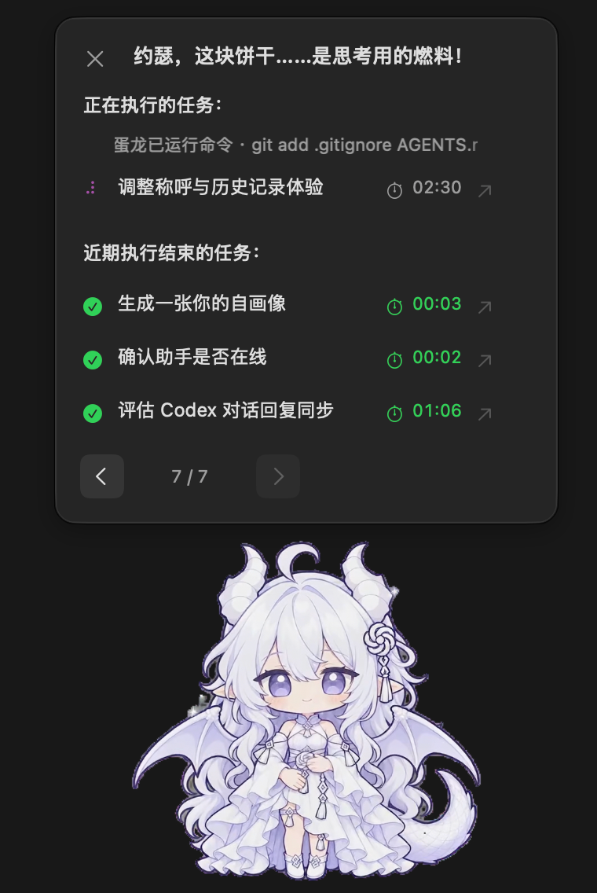
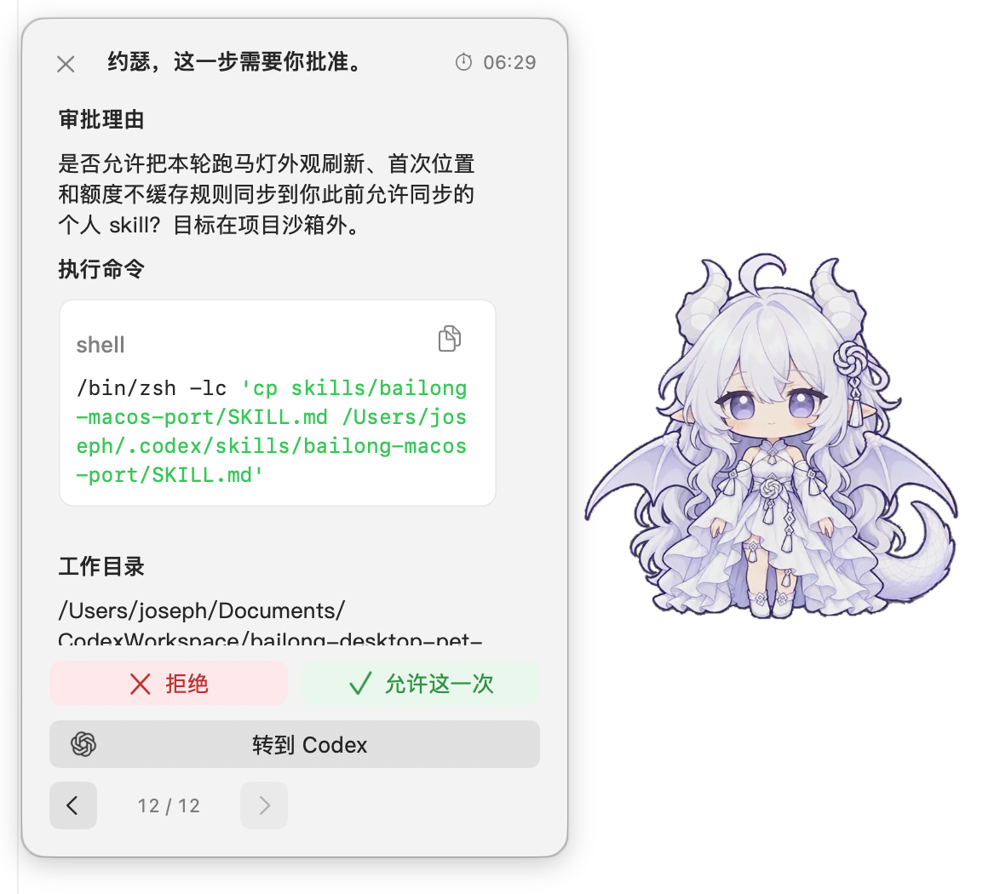
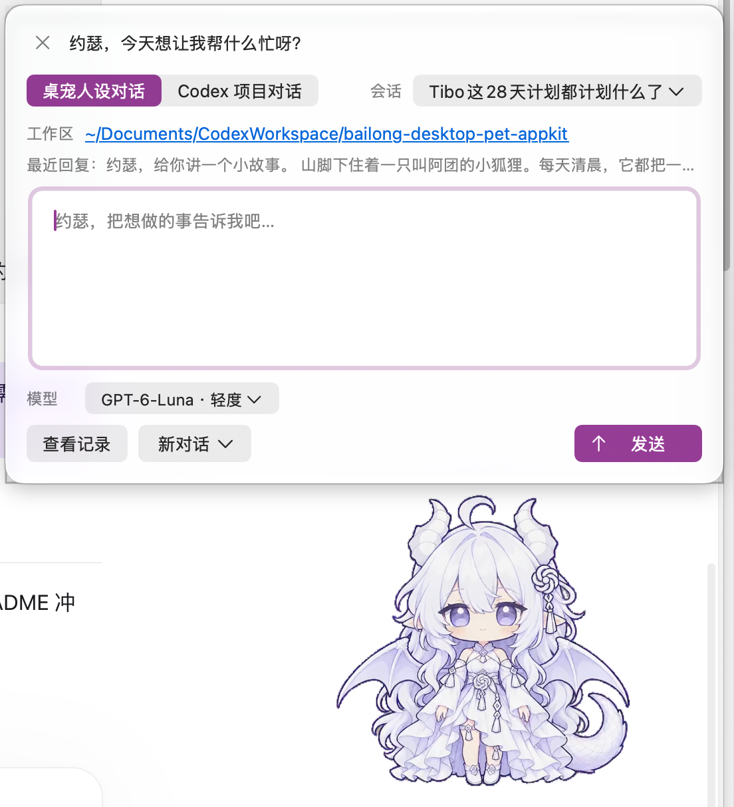
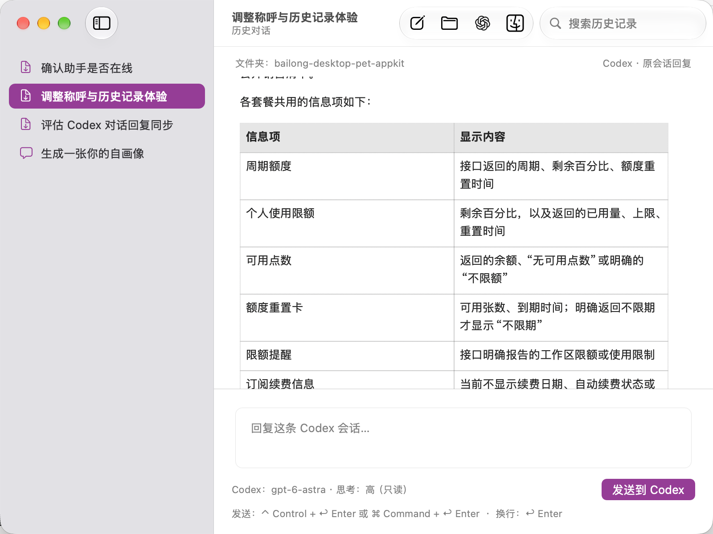
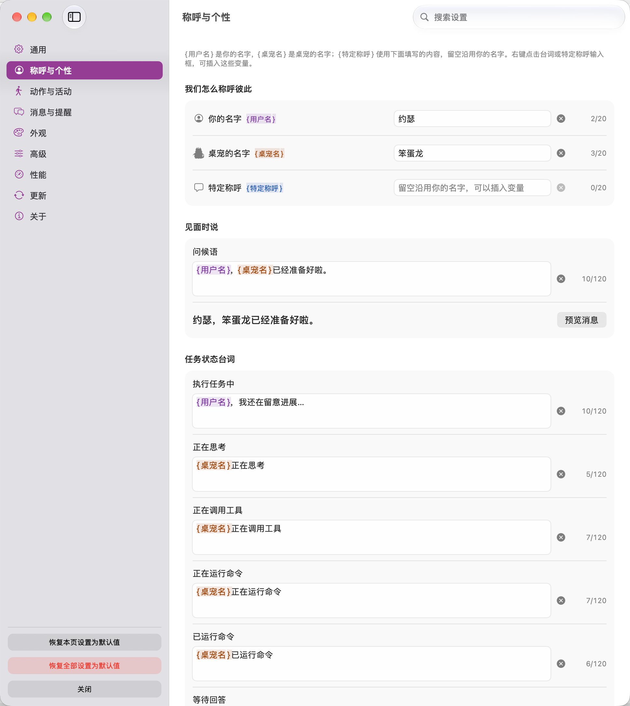
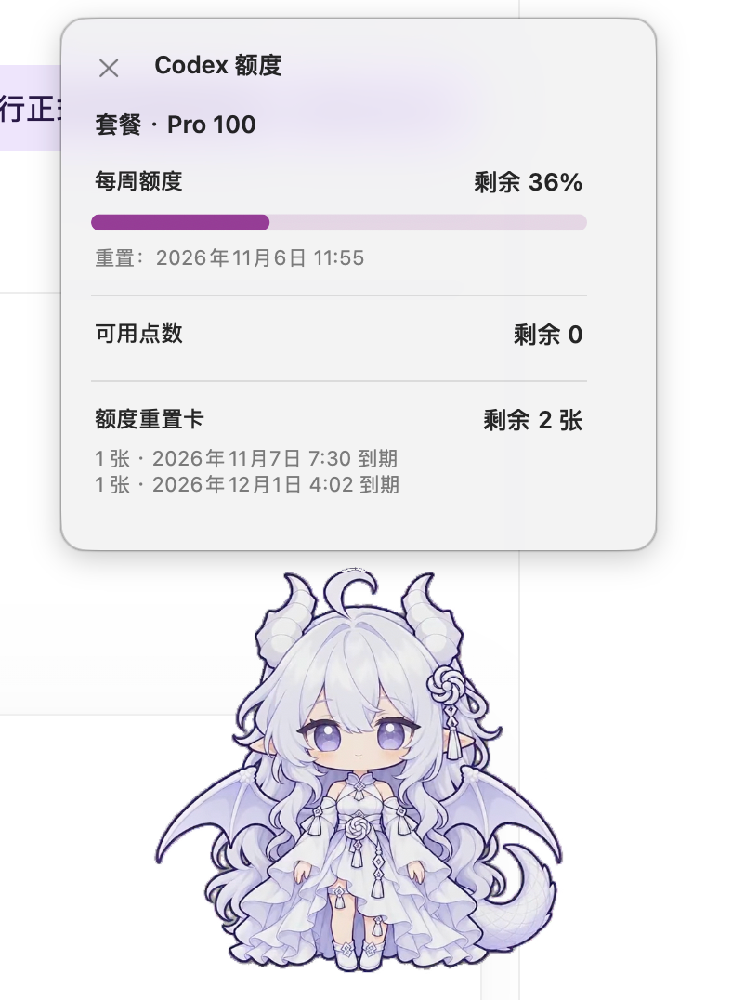

# 白龙桌宠Swift

**陪你工作，也把 Codex 的任务进展带到桌面。**

基于 [jingh12312-rgb 的 GPT白龙娘动态桌宠](https://github.com/jingh12312-rgb/bailong-desktop-pet)，由 Codex 进行 Swift + AppKit 原生重写，独立维护。支持桌面互动、Codex 对话、任务气泡与本机历史管理。

[下载正式版](https://github.com/Joseph-Blue/bailong-desktop-pet-mac-swift/releases/latest) · [版本变化](CHANGELOG.md) · [反馈问题](https://github.com/Joseph-Blue/bailong-desktop-pet-mac-swift/issues)

**正式版：[0.6.0](https://github.com/Joseph-Blue/bailong-desktop-pet-mac-swift/releases/tag/白龙桌宠Swiftv0.6.0)。**

## 下载与使用

需要 **Apple Silicon Mac、macOS 14 或更新版本**。Codex 功能需要在本机安装并登录 Codex。

1. [下载 Apple Silicon 版（ZIP）](https://github.com/Joseph-Blue/bailong-desktop-pet-mac-swift/releases/latest) 并解压。
2. 将 `白龙桌宠Swift.app` 放到你选择的固定目录，从访达打开。
3. 在“设置 → 通用”中选择是否随登录或 Codex 启动。

App 使用本地签名。若 macOS 提示无法验证开发者，尝试打开一次，再到“系统设置 → 隐私与安全性 → 仍要打开”。[Apple 操作说明](https://support.apple.com/zh-cn/102445)

### 从旧版升级

退出旧桌宠，再打开新版。新版保留设置与历史，升级历史格式前会备份原文件。已经启用的启动项会在新版首次运行时更新；App 移动到新目录后，手动打开一次即可更新路径。

历史和任务文件位于 `~/Library/Application Support/BailongPetAppKit`。历史备份为 `conversations-before-schema2-<时间戳>.json`；若切回 0.2.1，使用升级前的备份。

## 特色功能

这里介绍截至 **0.6.0** 已有的功能，各版本的更新见 [变更记录](CHANGELOG.md)。截图可点击查看原图；消息气泡图保留自 0.5.0，其余为 0.6.0。

### 在桌面看进展，也能回看消息

Codex 工作时，桌宠会显示回复和需要你处理的提醒。单击桌宠，可以查看正在执行和最近结束的任务，以及各自的状态和用时；点击任务就能回到对应的 Codex 会话。

- **思考和工具调用分开显示**：查看公开的思考摘要，或正在读取文件、搜索、运行命令等具体操作；两类信息可以分别开关。
- **提醒频率由你决定**：进展默认显示在任务概览里，不占消息记录。想随时看到变化，可以开启自动小气泡，默认显示 2 秒，时长可调。
- **消息可以翻页**：气泡默认保留本次运行的 20 张消息卡片，可调整数量；正在翻阅旧消息或填写问卷时，不会被新卡片打断。

<p align="center">
  <a href=".github/images/task-progress.png"></a>
  <a href=".github/images/task-overview.png"></a>
</p>

### 直接回复、回答问题和处理审批

不用每次切回 Codex：在气泡里点“快捷回复”，就能继续原会话；任务还在执行时，也可以补充要求。回复沿用原会话的模型和思考等级。

- **处理审批**：Codex 发来审批时，气泡先展示申请理由，再展示命令等详情。可以直接拒绝或允许这一次；红叉、绿对钩配合文字区分操作，左右顺序可调，按回车不会误触。桌宠内发起的任务使用原生审批窗口。
- **回答问卷**：选择选项或输入文字，多道题可以上一题、下一题、跳过，翻页保留草稿，最后统一提交。敏感提问通过安全输入窗口或回到 Codex 处理。
- **开启新对话**：打开桌宠聊天窗，选择工作文件夹、模型和思考等级后发送；也可以继续已有对话、查看进展或停止任务。
- **选择发送快捷键**：支持 Command + Enter、Enter，以及 Control 或 Command + Enter 发送，输入框下方会显示当前用法。

<p align="center">
  <a href=".github/images/approval.png"></a>
  <a href=".github/images/quick-chat.png"></a>
</p>

### 找回聊过的内容

历史窗口集中保存桌宠中的对话和同步到本机的 Codex 会话。可以搜索正文、跳到匹配位置，也可以直接在右侧接着回复。

会话标题支持右键重命名、重新同步 Codex 标题或删除记录。删除的是桌宠保存的那份记录，不会删除 Codex 原会话；关闭历史记录后，已有内容保留，关闭期间不再记录。

<p align="center">
  <a href=".github/images/history.png"></a>
</p>

### 代码、表格和文件都能看

回复支持标题、列表、引用、表格和链接。代码放在圆角框中，支持基础语法着色和整块复制；长内容可以滚动阅读。

首次点击本机文件链接时，系统会请求控制访达的权限；允许后，桌宠会在访达中选中文件，并恢复对应的最小化窗口。点击应用包链接只定位文件，不运行应用。Codex 生成图片后，桌宠会显示可打开的图片文件入口。

### 名字、台词和外观自己定

你和桌宠的名字、问候语、互动台词、任务状态提示都可以修改。台词支持 `{用户名}`、`{桌宠名}`、`{特定称呼}`，右键输入框即可插入；特定称呼留空时沿用你的名字。

- **调整大小和形状**：分别设置桌宠大小、文字大小和气泡大小，也可以指定气泡宽高比。
- **选择颜色和材质**：外观可跟随系统或选择浅色、深色，强调色可以自定义；macOS 26 起支持液态玻璃，也能切回普通材质、调整背景不透明度并预览。
- **快速找到设置**：设置搜索覆盖具体选项、动作和台词，点击结果直接定位。历史与设置使用原生分栏窗口，绿灯按钮填满屏幕可用区域，再点一次恢复。

<p align="center">
  <a href=".github/images/personality.png"></a>
</p>

### 想热闹一点，或安静陪着

桌宠支持拖动、落地动画和吸边收起，也会按设置切换动作、在桌面活动。可以调整活跃程度、活动范围和播放速度，单独设置动作出现的频率，以及任务开始和结束时是否播放动画。

需要专心时，开启“安静陪伴”或设定专注时段：减少自主活动，停止自动移动、互动台词、进展小气泡和音效；最终回复与需要处理的提醒仍会保留。

### 查看额度，打开订阅管理

双击桌宠查询 Codex 额度，按账号返回的信息显示套餐、剩余额度、下次重置时间、点数和重置卡。**每次都重新查询，不使用上次结果。**

底部提供 ChatGPT 网页、Google Play 和 Apple 的订阅管理入口，免费用户也能看到。点击后打开对应平台；桌宠不显示订阅续费日期。

<p align="center">
  <a href=".github/images/codex-quota.png"></a>
</p>

### 动画播放和日常维护

- **原画与性能可调**：默认 720×720，另有 512、384、256 三档；可以调整帧率和缓冲。动画默认边读取边播放，保留 24 帧缓冲，切换动作后释放旧缓冲。
- **安装包约 112 MiB**：0.6.0 的 Apple Silicon ZIP 为 112.38 MiB，早期 0.2.1 为 168.91 MiB。动画使用透明 HEVC，由系统 AVFoundation 播放，不再随包附带 FFmpeg。
- **按需查看性能**：独立窗口显示 FPS、CPU、GPU、运行内存 (RAM) 和动画缓冲，关闭后停止统计。
- **按需启动和检查更新**：可设为登录启动或随 Codex 启动；更新页可以检查正式版本并打开下载页，启动自动检查默认关闭。
- **集中管理本机数据和权限**：设置中提供访达授权、文件权限、登录项入口，以及本应用的数据和缓存清理。历史格式升级前会备份原文件。

## 常用操作

| 操作 | 默认行为 |
| --- | --- |
| 单击 / 双击桌宠 | 随机动画与任务概览 / 查询额度 |
| 右键单击 / 右键双击 | 打开菜单 / 临时聊天 |
| 吸边时单击或拖出 | 召回桌宠 |
| ⌘ Command + ↩ Enter | 发送消息；Enter 换行 |
| ⌘, | 打开设置 |
| 设置或历史中的 ⌘F | 搜索设置项或历史消息 |
| 历史中的 ⌘G / ⇧⌘G | 下一处 / 上一处正文匹配 |

鼠标动作、发送快捷键和消息时长均可调整。右键菜单提供随机动画、Codex 跳转、历史，以及大小和称呼台词设置入口。

- 气泡默认保留本次运行的 **20 张卡片**，可设为 5～100；磁盘历史单独保存。
- 鼠标移入气泡暂停倒计时，移出接着计时；切换卡片重新计时。待回答、待批准和错误气泡由用户处理后关闭。
- 新任务消息替换任务概览；正在翻阅旧卡或填写问卷时保留当前卡片。
- 关闭窗口或按 ⌘Q 收起界面；完整退出使用菜单中的“退出白龙桌宠Swift”。停止任务使用对话中的“停止”。

## 性能设置

| 设置 | 默认 | 可选 |
| --- | --- | --- |
| 画质 | 原画 720×720 | 512×512、384×384、256×256 |
| 素材帧率 | 满帧，按实际素材帧率 | 20 / 15 FPS |
| 动画缓冲 | 24 帧 | 6～240 帧 |
| 整段预加载 | 关闭 | 开启后完整加载当前动作，占用更多运行内存 (RAM) |

流式播放和整段预加载可按设备调整；独立性能窗口提供当前占用与帧率。实现细节见 [来源与架构](docs/来源与架构.md)。

## 从源码构建

需要 Apple Command Line Tools，以及以下本地资源：

```text
local-assets/
  native-hevc/catalog/素材清单.json
  native-hevc/catalog/透明HEVC/*.mov
  sounds/click.wav
  sounds/来源.txt
  glass-symbols/
  BailongPet.icns
  openai-logo.png
```

资源不存放在 Git 中，可从原生 HEVC 版 App 的 `Contents/Resources` 提取。PNG 素材接入见 [原生素材工具](Tools/NativeHEVC/README.md)。

```sh
./scripts/build.sh arm64           # 构建 Apple Silicon App
./scripts/run-dev.sh --build-only  # 仅编译
./scripts/run-dev.sh               # 开发运行
```

也可双击 `build.command`、`launch.command`、`run-dev.command`。构建版本取自 [VERSION](VERSION)，产物位于 `dist/native-hevc/<VERSION>/arm64/白龙桌宠Swift.app`。Intel 源码构建入口为 `./scripts/build.sh x86_64`。

## 来源与反馈

原作参考基线为 **v0.5.1 / b102e73**。动画、音效、图标与软件组件的来源见 [来源与架构](docs/来源与架构.md) 和设置中的“关于 → 开源项目、技术栈与致谢”。

反馈问题请提供应用版本、macOS 版本和复现步骤；Codex 问题另附桌面端版本，并注明桌宠内置对话或 Codex 原会话。[提交 Issue](https://github.com/Joseph-Blue/bailong-desktop-pet-mac-swift/issues)
